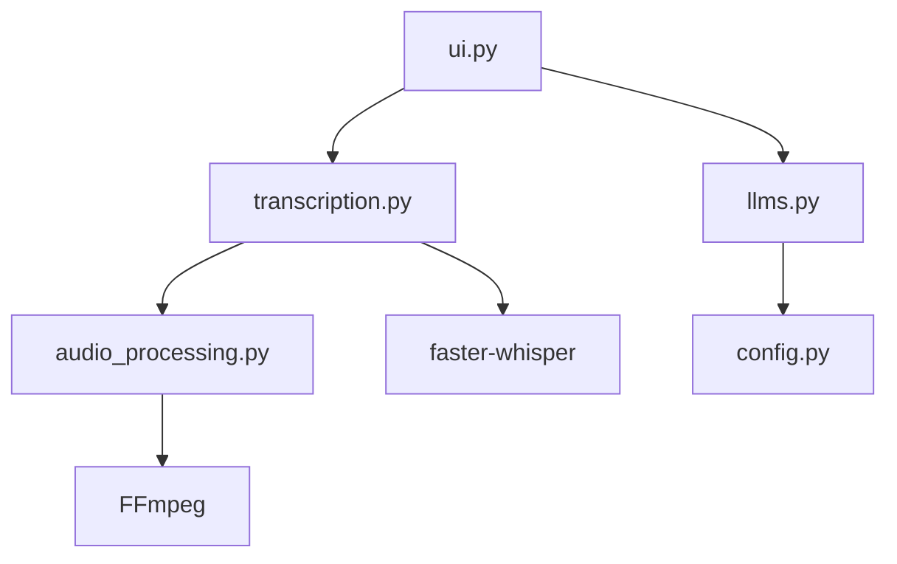

[⬅ Previous](./05-deployment.md) | [🏠 Index](./README.md) | [Next ➡](./07-examples.md)

# Installation

The `whisper-utility` is a Python-based application designed for local audio transcription and LLM-assisted processing. It leverages `faster-whisper` for high-performance speech-to-text and integrates with local (Ollama) or cloud (Gemini) LLMs for post-processing.

This document outlines the system requirements, environment setup, and build procedures for deploying the utility.

## System Requirements

The application supports both CPU and GPU-accelerated inference. Ensure your environment meets the following criteria before proceeding.

| Component | Requirement |
| :--- | :--- |
| **OS** | Windows 10/11, Linux x64, macOS Intel/Apple Silicon |
| **Python** | 3.10 or 3.11 |
| **FFmpeg** | Required for audio/video processing (must be in system PATH) |
| **Hardware (CPU)** | Minimum 8GB RAM, AVX2 support recommended |
| **Hardware (GPU)** | NVIDIA GPU with CUDA support (Compute Capability 5.0+) |

## Environment Setup

The project provides separate dependency files to optimize for hardware capabilities.

### 1. Clone the Repository
```bash
git clone https://github.com/CorsiDanilo/Whisper-Audio-Video-Transcription-App.git
cd Whisper-Audio-Video-Transcription-App
```

### 2. Create Virtual Environment
It is recommended to use a virtual environment to isolate dependencies.

```bash
python -m venv venv
# Windows:
.\venv\Scripts\activate
# Linux/macOS:
# source venv/bin/activate
```

### 3. Install Dependencies
Choose the installation path based on your operating system and hardware:

**Windows CPU-only:**
```bash
pip install -r requirements_cpu.txt
```

**Windows GPU-accelerated:**
```bash
pip install -r requirements_gpu.txt
```

**Linux CPU:**
```bash
pip install -r requirements_linux.txt
```

**macOS:**
```bash
pip install -r requirements_macos.txt
```

Do not install the Windows requirement files on Linux or macOS. On Linux,
install the native desktop/build dependencies with `python3-tk
libgirepository-2.0-dev libcairo2-dev pkg-config gir1.2-gtk-3.0
libgtk-3-0 libwebkit2gtk-4.1-0`.

## Architecture Overview

The application utilizes a modular architecture where the UI layer (`ui.py`) orchestrates calls between the transcription engine (`transcription.py`) and the LLM interface (`llms.py`).



## Building the Executable

The project includes a cross-platform `PyInstaller` pipeline. Windows and
Linux produce the `Whisper` directory layout; macOS produces a
Finder-compatible `Whisper Utility.app` bundle. The build bundles the Gradio
web interface and the required runtime hooks.

### Build Configuration
The build process is defined in `whisper.spec` and executed via `app_main.py`. The `hooks/hook-gradio.py` file ensures that Gradio's static assets are correctly included in the final bundle.

### Execution Command
To generate the platform-specific release from the project root:

```bash
python tools/build_release.py
```

The resulting archive is `dist/whisper_app_win.zip`,
`dist/whisper_app_linux.zip`, `dist/whisper_app_mac_x64.zip`, or
`dist/whisper_app_mac_arm64.zip`, depending on the platform.

## Configuration

The application relies on YAML configuration files located in the `/settings` directory.

*   `settings/default.yaml`: Base configuration for application startup.
*   `settings/cpu.yaml`: Optimized settings for CPU-only inference.
*   `settings/gpu.yaml`: Optimized settings for CUDA-enabled inference.

To modify the application behavior, edit the relevant YAML file. The `config.py` module handles the loading logic:

```python
# Example: Loading configuration in the application
from config import load_default_config

config = load_default_config()
# Access parameters like config['whisper_model'] or config['device']
```

## Smart Installer & In-App Auto-Updater

Whisper Utility provides a built-in update checking and installation mechanism:

- **Interactive Check**: In the Gradio UI under `Settings` (`Configurazioni`), click **Check for Updates** (`Verifica Aggiornamenti`).
- **Release Source**: The updater reads the latest published GitHub release tag through the GitHub Releases API. The installer manifest remains hosted on the repository's `main` branch and contains the platform-specific package URLs.
- **Dynamic Action**:
  - If a newer release is published on GitHub, a **Download & Install v{latest}** button appears.
  - If the application is already up to date, a **Reinstall / Repair Current Version** button is available, allowing users to re-run setup and repair components or configuration on demand.
- **Detached Process Execution**: The installer wizard launches as a detached background process (using `pythonw.exe` on Windows) so that the running web server and UI remain responsive.
- **Frozen Executable Fallback**: When packaged with PyInstaller, the updater detects bundled `WhisperUtilitySetup_Windows.exe` or redirects automatically to GitHub Releases if a standalone setup binary is not co-located.
- **Release Metadata**: `version.py` is the source of the application version and repository identifier. The release workflow validates these values against the pushed tag before building installers.

## Troubleshooting

### FFmpeg Errors
If the application fails to process audio or video files, verify that `ffmpeg` is installed and accessible in your system environment variables.
*   **Test:** Run `ffmpeg -version` in your terminal.
*   **Fix:** Download from [ffmpeg.org](https://ffmpeg.org/), extract, and add the `/bin` folder to your Windows PATH.

### Missing DLLs (GPU)
If you are using the GPU version and receive CUDA-related errors:
1.  Ensure the NVIDIA CUDA Toolkit (matching the version required by `faster-whisper`) is installed.
2.  Verify that `cudnn` is correctly configured in your system path.

### Log Files
The application generates logs to assist in debugging. If the UI fails to launch, check the log file generated by `config.setup_logging()` to identify initialization failures.

---

### Why included

**Reason:** Architecture 'cli' recommends this section

**Confidence:** 100%

[⬅ Previous](./05-deployment.md) | [🏠 Index](./README.md) | [Next ➡](./07-examples.md)
